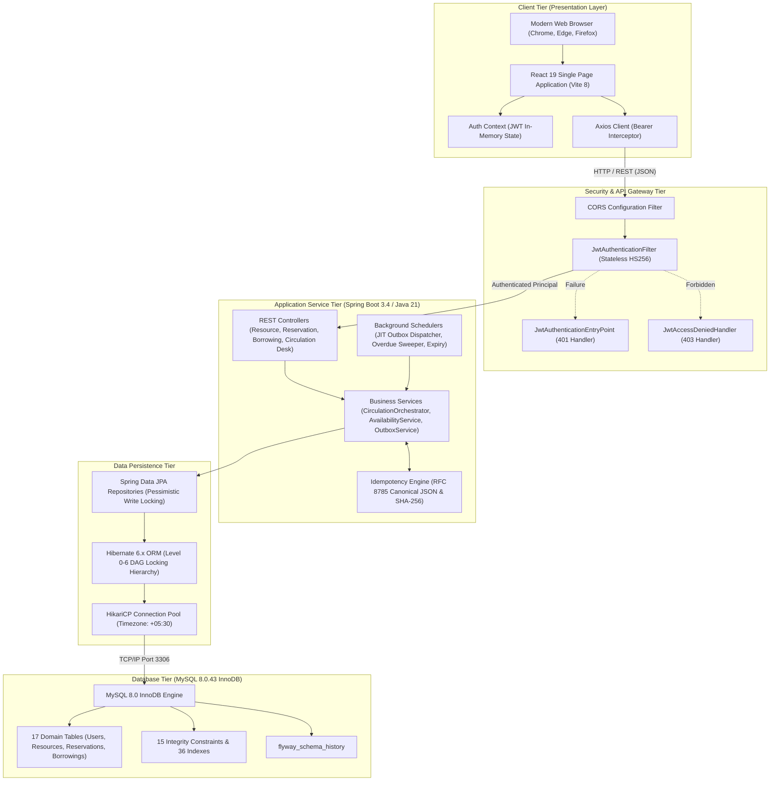
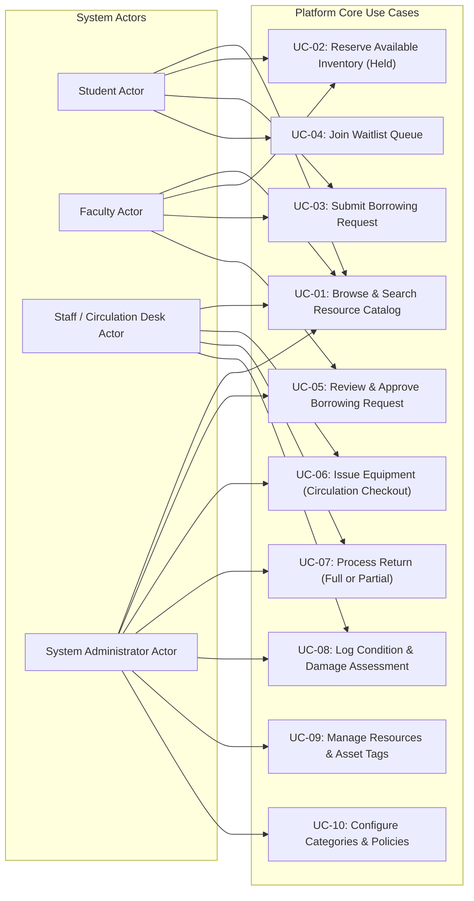
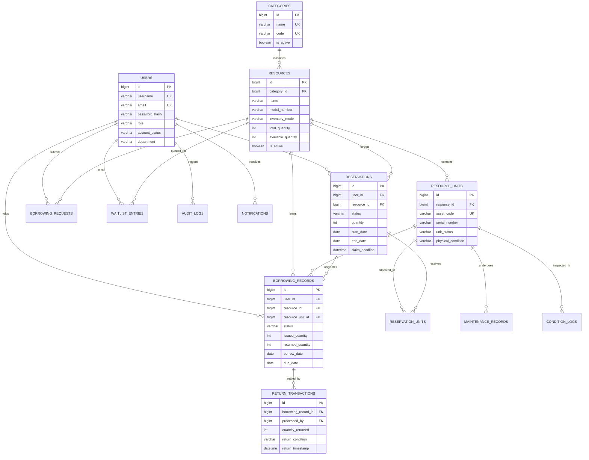
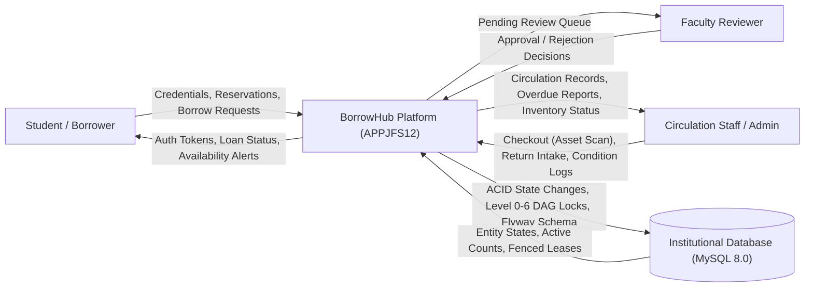
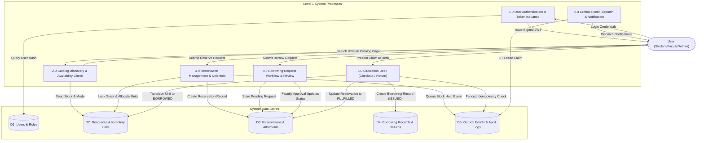
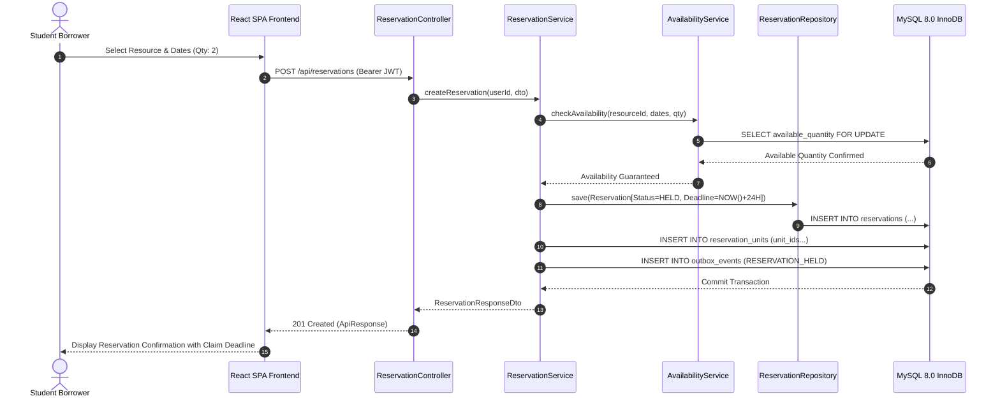
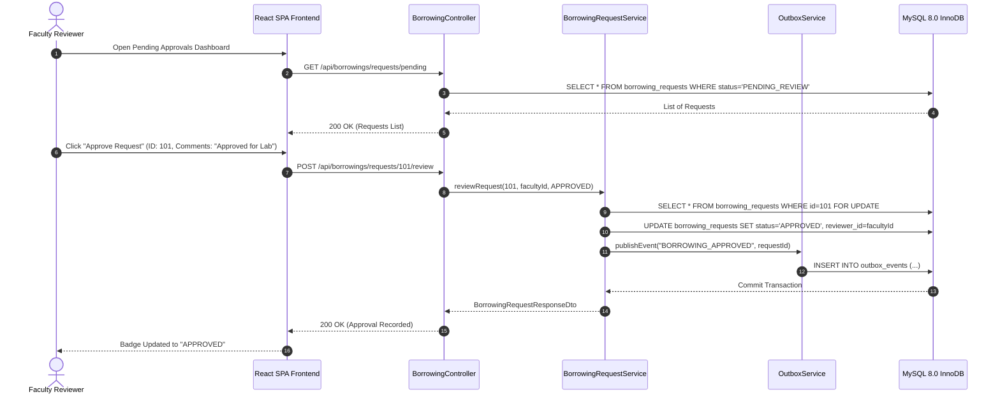
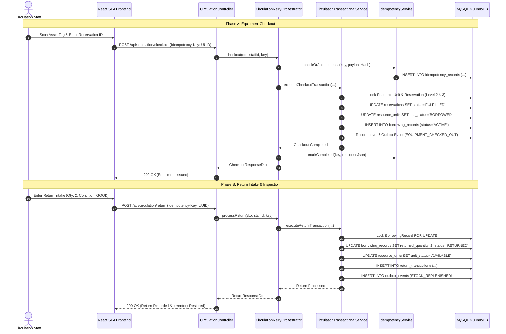
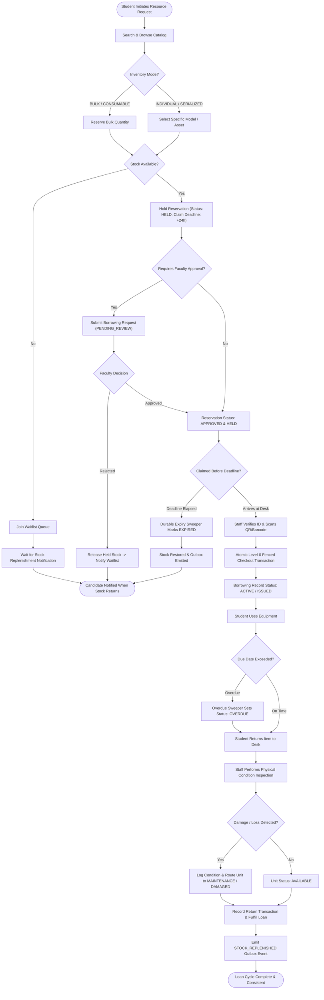

# BorrowHub – Academic Architectural Diagrams & System Models

**Project Code:** APPJFS12  
**Standard:** IEEE 1471 / ISO/IEC 42010 Architecture Documentation  
**Platform Version:** 1.0.0  

---

## 1. System Architecture Diagram

---

## 2. Use Case Diagram

---

## 3. Entity Relationship Diagram (ERD)

---

## 4. Data Flow Diagram – Level 0 (Context Level)

---

## 5. Data Flow Diagram – Level 1

---

## 6. Sequence Diagram: Resource Reservation

---

## 7. Sequence Diagram: Borrowing Approval

---

## 8. Sequence Diagram: Circulation Checkout and Return

---

## 9. Activity Diagram: Resource Borrowing Lifecycle

